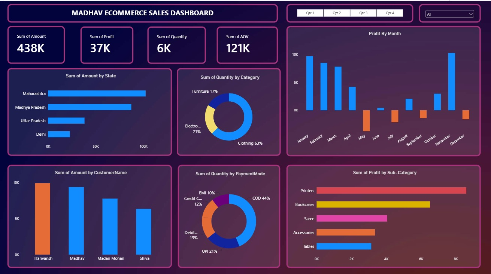

# E-Commerce Sales Analytics Dashboard

## Business Objective
Designed an end-to-end Power BI dashboard for an online retail client to track sales performance, identify VIP customers, and isolate top-performing regional markets to optimize marketing spend.

## The Final Dashboard

## Technical Execution
* **ETL & Data Cleaning:** Used Power Query to extract data from raw CSV files (`Orders.csv` and `Details.csv`), standardize date formats, and engineer custom calculated columns (e.g., Average Order Value).
* **Data Modeling:** Built a relational Star Schema connecting demographic lookup tables with transactional fact tables via a 1-to-Many relationship using `Order ID`.
* **DAX (Data Analysis Expressions):** Wrote custom DAX measures to aggregate metrics and dynamically format profit charts to highlight financial losses automatically.

## Key Business Insights (The 80/20 Rule)
1. **Category Dominance:** Clothing drives 62% of total order volume, significantly outpacing Electronics and Furniture.
2. **Regional Targeting:** Maharashtra emerged as the highest-grossing state, providing a clear geographic target for future localized ad spend.
3. **Customer Loyalty:** Identified the top VIP customers driving the most revenue, enabling targeted retention and cross-selling campaigns.
